# Little Plaza

A shared town square, live in the browser, where every visitor is a cursor.

No sign-up and no profiles: you show up, wander around with your mouse (or your finger), play with the attractions, chat with whoever is nearby and collect stickers.

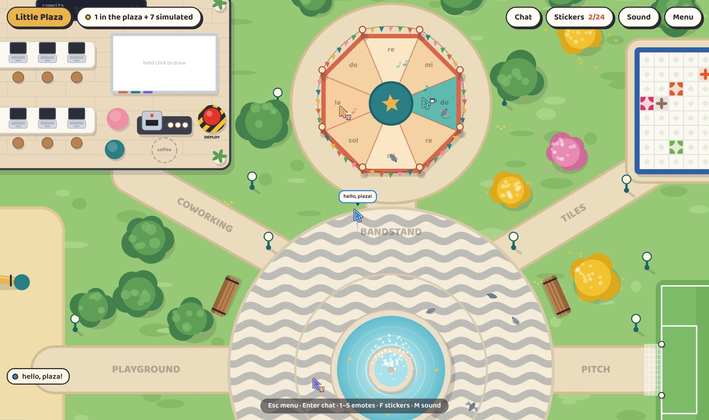

## Where it comes from

Little Plaza is an independent project. The genre, a shared place where every visitor is a cursor, became widely known through **Cursor Camp** by Neal Agarwal ([neal.fun](https://neal.fun)). The name, art, map, sounds and code here are our own; nothing was copied from it.

## What's in the plaza

| Place | What you do there |
| --- | --- |
| **Bandstand** | The floor has eight slices, and each one plays a note. Several cursors make music together. |
| **Fountain** | Walking into the water splashes. Click from the rim to toss a coin; the wish count is shared by everyone. |
| **Pigeons** | They take off when someone rushes past and follow anyone holding popcorn. |
| **Popcorn cart** | Wait on the mark to get a bag of popcorn. You drop kernels as you walk. |
| **Playground** | A seesaw that tips toward the side with more cursors, swings you pump in rhythm, and hopscotch. |
| **Pitch** | A ball with physics, two goals and a shared scoreboard. |
| **Tile mural** | A collaborative mural: each click paints a tile in your color. |
| **Flowerbed** | Each click plants a flower everyone can see. |
| **Coworking deck** | Laptops that "code" and add commits to a big screen, a shared whiteboard, coffee and a deploy button. |
| **Arcade** | Three original mini-games (Popcorn Catch, Worm, Rally) with plaza-wide high scores, plus a dance floor. |
| **Chat** | Press Enter to type. Only people near you can read it, and it fades in seconds. |
| **Stickers** | 24 stickers, three of them secret. They are saved in your browser. |

At night (by the visitor's own clock) the street lamps come on and fireflies appear.

## Screenshots

| | |
| --- | --- |
| 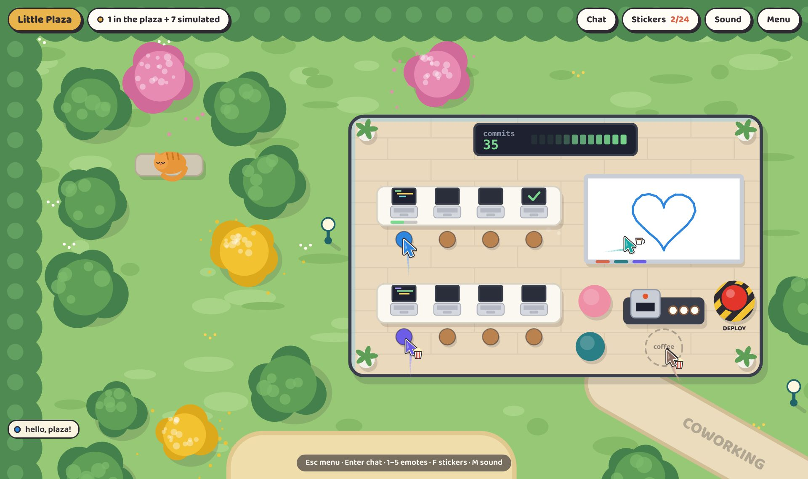 | 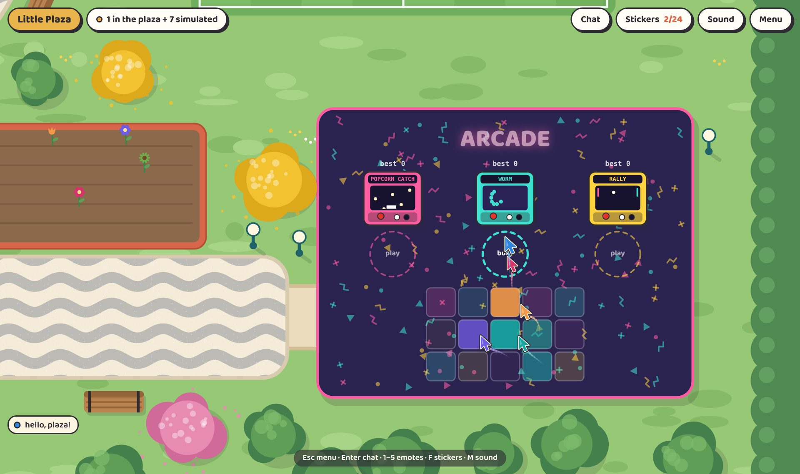 |
| **Coworking deck.** Sit at a laptop to code, draw on the whiteboard, hit deploy. | **Arcade.** Three machines and a dance floor that plays notes. |
| 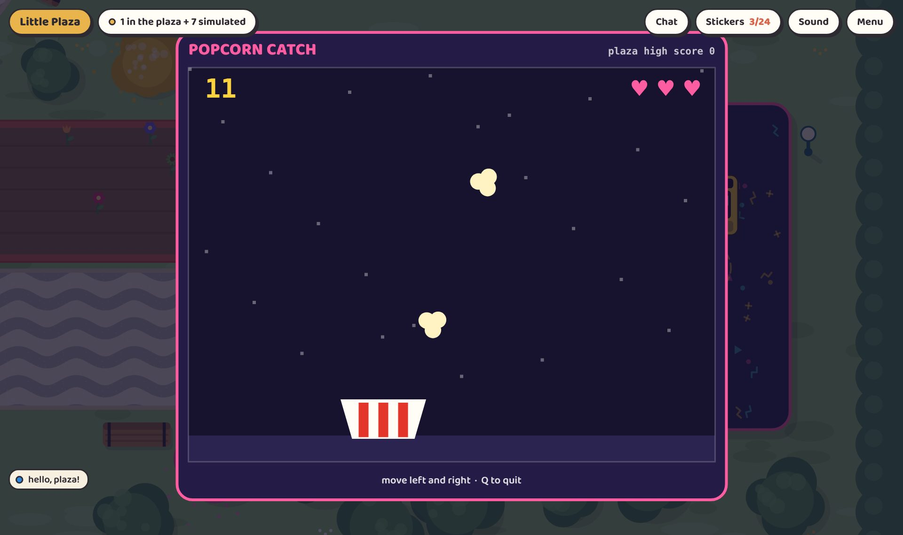 | 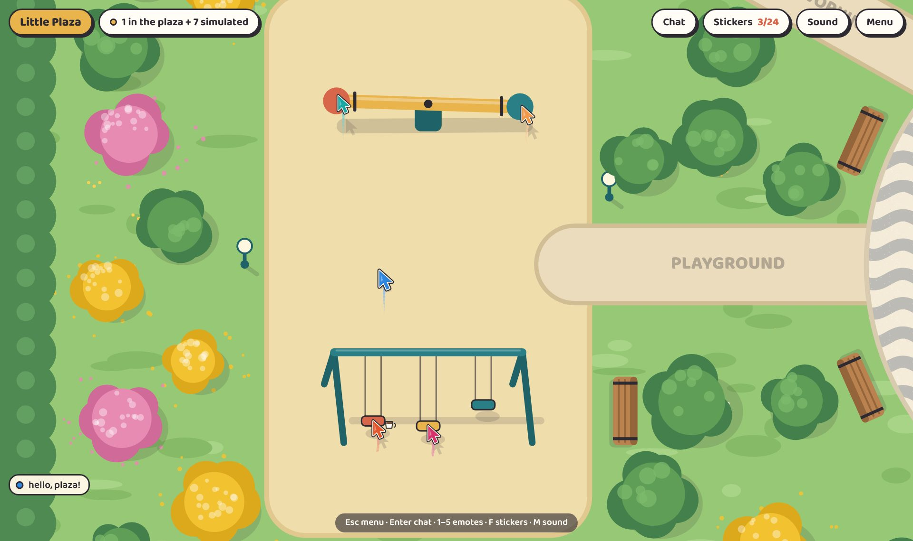 |
| **Popcorn Catch**, one of the three mini-games. | **Playground.** Seesaw and swings. |
| 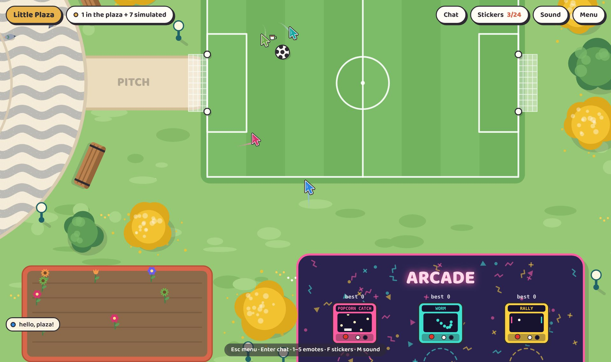 | 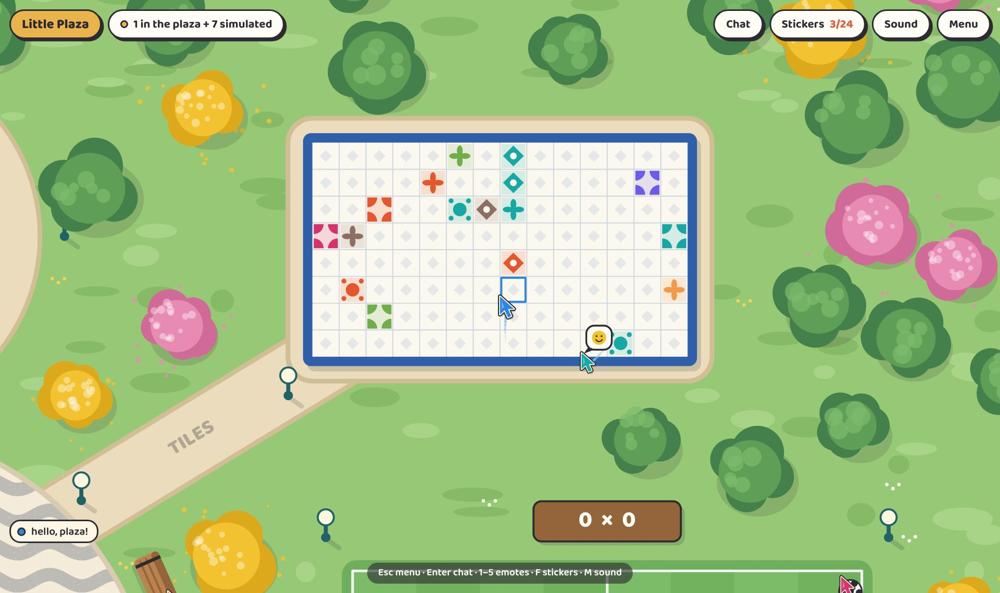 |
| **Pitch.** Kick the ball by running into it. | **Tile mural**, painted by everyone. |
| 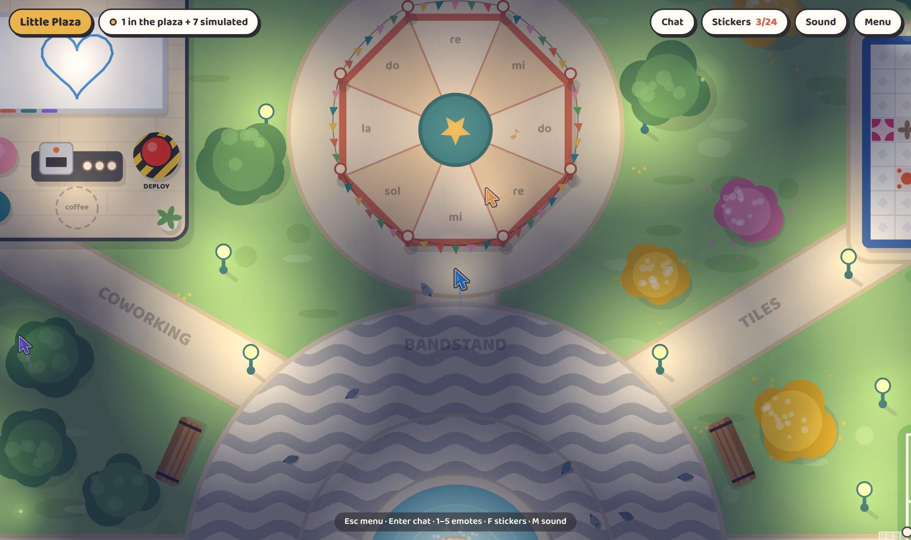 | 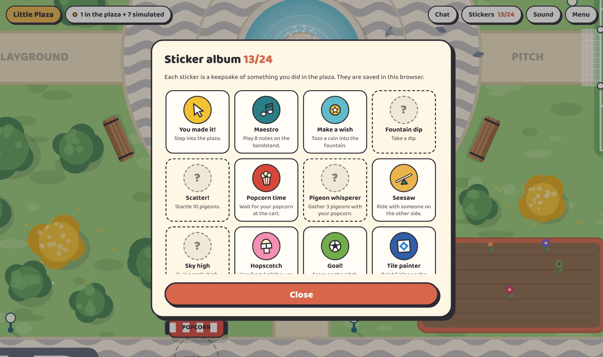 |
| **Night.** Lamps, glowing screens and fireflies. | **Sticker album.** Keepsakes of what you did. |
| 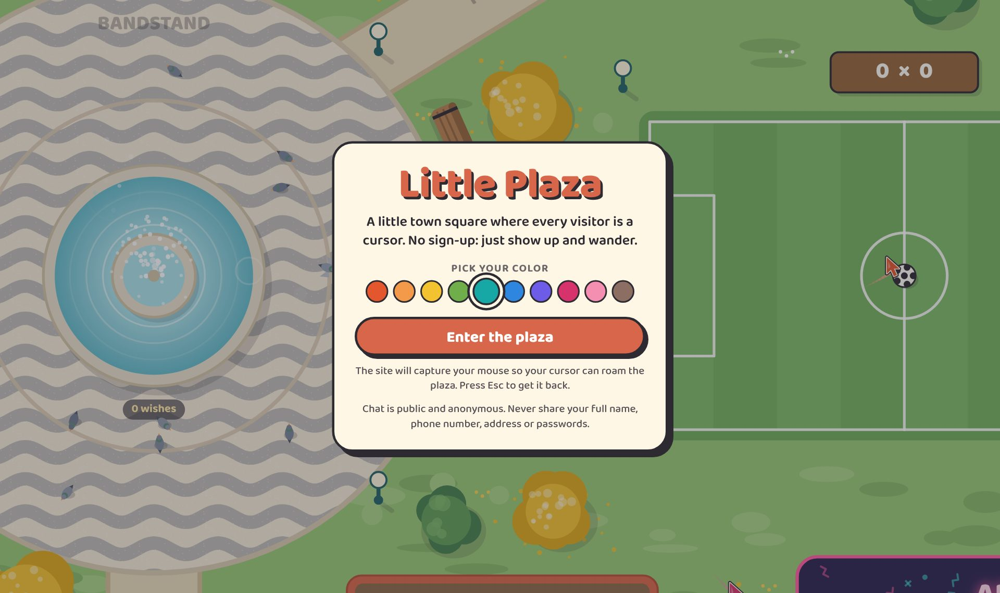 | 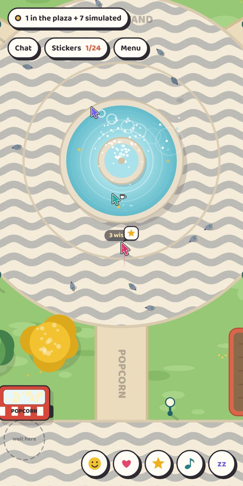 |
| **Start screen.** Pick a color and walk in. | **On a phone**, your finger works like a trackpad. |

## Controls

- **Mouse:** move to walk. The site captures the mouse so your cursor can roam the whole plaza; **Esc** gives it back.
- **Click** to act: toss a coin, paint a tile, plant a flower, type on a laptop, start a game.
- **Enter** opens the chat. **1–5** show emotes. **F** opens the sticker album. **M** toggles sound.
- **Touch:** drag like a trackpad; a quick tap is a click.

## Run it locally

```bash
npm install
```

```bash
npm run dev
```

Open the address it prints. With nothing else running, the site starts in **demo mode**: the other cursors are simulated (the top bar says so) and real multiplayer only happens between tabs of the same browser.

To try real multiplayer on your machine, start the real-time server in a second terminal:

```bash
npm run relay
```

Then create a `.env.local` file with:

```
VITE_REALTIME_URL=ws://localhost:8787
```

## Deploy

There are two pieces.

**1. The website, on Vercel.** Import the repository. Vercel detects Vite on its own (build command `npm run build`, output folder `dist`). `vercel.json` only adds security headers.

**2. The real-time server.** This is `server/relay.mjs`, a Node process that stays up and keeps WebSocket connections open. Any host that runs Node continuously works (Render, Railway, Fly.io, a VPS):

- install: `npm install`
- start: `npm run relay`
- set `ALLOWED_ORIGINS` to your site's address, for example `https://your-site.vercel.app`. Without it the server accepts connections from any website.

Then, on Vercel, add the environment variable `VITE_REALTIME_URL` with the server's address (`wss://...`) and redeploy. Without that variable the deployed site stays in demo mode.

More server settings (per-room, per-address and total limits) are documented at the top of `server/relay.mjs`.

The server keeps the plaza's state (tiles, flowers, coins, score, commits, high scores) in memory only: if it restarts, the plaza starts fresh. Chat messages are never stored.

> Vercel announced WebSocket support for Functions in 2026. This project does not rely on it: those connections are time-limited, and visitors landing on different function instances would not see each other without an external store.

## Chat safety

What is in place:

- Every message goes through the same rules in the browser and on the server (`shared/protocol.js`). The server never forwards what it received as-is; it rebuilds each message field by field.
- A 120-character limit and one message every 1.2 seconds per visitor, enforced on the server.
- Links, e-mail addresses, runs of 8 or more digits and a list of profanity (English and Portuguese) are replaced with `•••`.
- Text is drawn on the canvas or inserted as plain text. It never becomes HTML.
- Nothing is stored, and there are no names or profiles.
- Visitors can turn the chat off in the menu.

What does **not** exist yet, and needs a decision before you promote the site:

- Human moderation, reporting, muting a specific visitor, and bans.
- Age checks. An open, anonymous chat on a playful-looking site attracts children.
- A word filter is easy to get around. It reduces the problem; it does not solve it.

## Handy URLs for testing

- `?mode=free`: does not capture the mouse; the camera moves when the cursor reaches the edge.
- `?hour=21`: forces the time of day (to see the night).
- `?room=name`: opens a separate plaza.
- `?debug`: exposes the game as `window.__pracinha` in the console.

## Project layout

```
index.html            page and interface text
shared/protocol.js    network rules and chat filter (used by both site and server)
server/relay.mjs      real-time server
src/main.ts           entry point
src/game.ts           main loop: input, network, camera, drawing
src/ui.ts             HTML screens: start, menu, album, chat, notifications
src/input.ts          captured mouse, free mouse and touch
src/net/              local transport (between tabs) and WebSocket transport
src/store.ts          shared state
src/actors.ts         drawing of cursors, emotes and speech bubbles
src/bots.ts           simulated visitors for demo mode
src/album.ts          stickers
src/audio.ts          every sound, synthesized on the fly (there are no audio files)
src/arcade/           the three mini-games
src/world/            scenery and one class per attraction
```

Code comments are in Portuguese.

To rename the site, change "Little Plaza" in `index.html`. Colors live in `src/config.ts`. Each attraction is a file in `src/world/` that implements the `Activity` interface from `src/types.ts`; to add one, write the class and add it to the list in `src/game.ts`.

## What has been tested

With an automated browser: every attraction, the chat and its filter, the sticker album, night mode, touch controls on a phone-sized screen, two tabs in demo mode, three browsers connected to the real-time server (presence, chat, shared state, the ball, goals, host hand-off), and the production build served with the headers from `vercel.json`.

Not tested yet: a real Vercel deployment, the server on a real host, browsers other than Chromium, and the plaza with many people at once.
